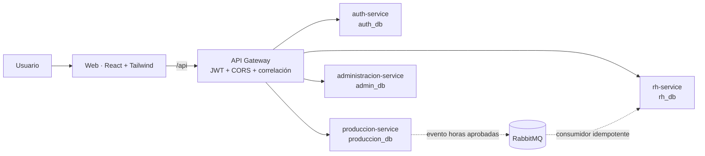

# Nómina360

Sistema de control de nóminas **multiárea** construido como **monorepo multipaquete**:
un frontend React con *Screaming Architecture* y cinco microservicios Java (Spring Boot, MVC)
con **una base de datos PostgreSQL por área**.

> Estado: scaffold ejecutable de punta a punta (login → empleados → periodos → cálculo →
> aprobación de horas → pago contra presupuesto). Las tablas fiscales incluidas son de
> referencia y deben validarse antes de operar con nómina real (ver [límites](#límites-conocidos)).

---

## Lo que incluye

| Área | Capacidad | Dónde |
| --- | --- | --- |
| Autenticación | Login JWT, refresh rotativo, roles por área | `backend/services/auth-service` |
| Recursos Humanos | Empleados, incidencias, periodos, cálculo de ISR/IMSS, recibos | `backend/services/rh-service` |
| Producción | Centros de trabajo, turnos, horas, aprobación y evento a RH | `backend/services/produccion-service` |
| Administración | Centros de costo, presupuesto, proveedores, pagos | `backend/services/administracion-service` |
| Borde | Ruteo, CORS, validación de JWT, correlation ID | `backend/services/api-gateway` |
| Web | Login animado (anime.js), tablero, nómina, empleados, producción, presupuesto | `apps/web` |

---

## Arquitectura en 30 segundos



- **Database per service**: `auth_db`, `rh_db`, `produccion_db`, `admin_db` en instancias
  PostgreSQL separadas (puertos 5433–5436). Ningún servicio lee la base de otro.
- **Comunicación síncrona** sólo a través del gateway (REST/JSON).
- **Comunicación asíncrona** para el flujo Producción → RH con patrón *outbox* y consumidor
  idempotente (`eventos_procesados`).
- Cada servicio sigue un MVC por capas: `api/` (controladores) → `servicio/` (casos de uso)
  → `dominio/` + `repositorio/`.

Detalle completo: [docs/ARQUITECTURA.md](docs/ARQUITECTURA.md) · Decisiones: [docs/DECISIONES.md](docs/DECISIONES.md)

---

## Stack

| Capa | Tecnología |
| --- | --- |
| Frontend | React 19, TypeScript, Vite 6, Tailwind CSS 3.4, anime.js 3, React Router 7 |
| Estado/HTTP | Cliente propio tipado en `@nomina360/core` (refresh transparente de JWT) |
| Backend | Java 21, Spring Boot 3.4, Spring Security, Spring Data JPA, Flyway, Spring Cloud Gateway |
| Mensajería | RabbitMQ 3.13 (topic exchange + dead-letter queue + outbox) |
| Datos | PostgreSQL 16, una instancia por área |
| Infra | Docker Compose, imágenes multi-stage, GitHub Actions, GHCR |
| Calidad | JUnit 5 + AssertJ, Vitest + Testing Library, ESLint 9, TypeScript estricto, Prettier |

---

## Arranque rápido

Requisitos: Docker Desktop (o Docker + Compose v2). Para desarrollo sin Docker, ver
[docs/DESARROLLO.md](docs/DESARROLLO.md).

```bash
cp .env.example .env          # cambia JWT_SECRET y contraseñas
docker compose up --build -d
```

| Servicio | URL |
| --- | --- |
| Web | http://localhost:8088 |
| API Gateway | http://localhost:8080 |
| Swagger auth | http://localhost:8081/swagger-ui.html |
| Swagger RH | http://localhost:8082/swagger-ui.html |
| Swagger Producción | http://localhost:8083/swagger-ui.html |
| Swagger Administración | http://localhost:8084/swagger-ui.html |
| RabbitMQ (consola) | http://localhost:15672 (`nomina` / `nomina_dev_pass`) |
| PostgreSQL auth / RH / producción / admin | `localhost:5433` / `5434` / `5435` / `5436` |

### Usuarios de demostración

| Rol | Correo | Contraseña |
| --- | --- | --- |
| Administrador | `admin@nomina360.mx` | `Nomina360!` |
| Recursos Humanos | `rh@nomina360.mx` | `Nomina360!` |
| Producción | `produccion@nomina360.mx` | `Nomina360!` |
| Administración | `admin.finanzas@nomina360.mx` | `Nomina360!` |

Los usuarios se crean al primer arranque de `auth-service` (desactívalo con
`NOMINA_DATOS_INICIALES_ENABLED=false`). **Cámbialos antes de usar datos reales.**

### Recorrido sugerido

1. Entra como `rh@nomina360.mx` → **Nómina** → abre *Enero 2026* → **Calcular**.
2. Revisa **Ver recibos**: percepciones, ISR, IMSS y neto por empleado.
3. Entra como `produccion@nomina360.mx` → **Producción** → aprueba un registro con horas extra.
4. Vuelve a RH: las horas se integran como incidencia vía RabbitMQ (evento idempotente).
5. Entra como `admin.finanzas@nomina360.mx` → **Administración** → registra un pago y observa
   cómo se reduce el disponible del centro de costo.

---

## Estructura del repositorio

```text
nomina360/
├── apps/
│   └── web/                        # React + Vite + Tailwind (Screaming Architecture)
│       ├── src/
│       │   ├── app/                # composición: rutas y App
│       │   ├── shell/              # layout, navegación, iconos
│       │   ├── shared/             # hooks, componentes y utilidades transversales
│       │   └── features/
│       │       ├── auth/           # api · contexto · animaciones (anime.js) · pages
│       │       ├── dashboard/
│       │       ├── empleados/
│       │       ├── nomina/
│       │       ├── produccion/
│       │       └── administracion/
│       └── Dockerfile · nginx.conf
├── packages/
│   ├── core/                       # tipos, cliente HTTP, formato, validaciones zod
│   ├── ui/                         # design system compartido (botones, tablas, modales…)
│   └── tsconfig/                   # baselines de TypeScript
├── backend/
│   ├── libs/
│   │   ├── common-jwt/             # emisión/validación de JWT
│   │   ├── common-web/             # ApiError, paginación, correlación, excepciones
│   │   └── common-security/        # filtro JWT, SecurityFilterChain, BCrypt
│   ├── services/
│   │   ├── api-gateway/
│   │   ├── auth-service/
│   │   ├── rh-service/
│   │   ├── produccion-service/
│   │   └── administracion-service/
│   ├── pom.xml                     # reactor Maven (multi-módulo)
│   └── Dockerfile                  # imagen multi-stage compartida
├── infra/backup/                   # scripts de respaldo, cifrado, simulacro y pgBackRest
├── docs/                           # arquitectura, API, decisiones, desarrollo, respaldos
├── .github/workflows/              # CI backend/frontend, imágenes, respaldo, simulacro
└── docker-compose.yml              # 4 BD + RabbitMQ + 5 servicios + web
```

---

## Comandos

```bash
# Frontend
pnpm install
pnpm dev:web              # http://localhost:5173 (proxy /api → gateway :8080)
pnpm build                # turbo: build de todos los paquetes
pnpm test                 # Vitest (core + web)
pnpm lint && pnpm typecheck

# Backend
export JAVA_HOME=/ruta/al/jdk-21
mvn -f backend/pom.xml verify
mvn -f backend/pom.xml -pl services/rh-service spring-boot:run

# Stack completo
docker compose up --build -d
docker compose logs -f rh-service
docker compose down -v    # elimina también los volúmenes de datos
```

---

## Calidad y CI

| Workflow | Qué hace |
| --- | --- |
| `ci-backend.yml` | `mvn verify` (JUnit del motor de nómina) + build de las 5 imágenes |
| `ci-frontend.yml` | lint, typecheck, Vitest y build de producción |
| `publicar-imagenes.yml` | publica imágenes en GHCR al etiquetar `v*.*.*` |
| `respaldo-bases.yml` | respaldo lógico diario cifrado a S3 (runner self-hosted) |
| `simulacro-restauracion.yml` | restaura el último respaldo y valida tablas críticas |
| `dependabot.yml` | actualizaciones semanales de Maven, npm, Docker y Actions |

El motor de nómina tiene pruebas con valores calculados a mano (sueldo, ISR, IMSS,
prorrateo por ingreso, faltas y horas extra dobles/triples) para evitar regresiones.

---

## Respaldos

La recomendación completa está en **[docs/RESPALDOS.md](docs/RESPALDOS.md)**. Resumen:

1. **PITR con pgBackRest** por instancia (WAL continuo + full/incr) → RPO ≈ 5 min.
2. **Dump lógico diario** cifrado por base (`infra/backup/backup.sh`) → portabilidad y
   recuperación por área.
3. **S3 con Object Lock / versionado + cifrado**, copia en otra región, retención GFS.
4. **Simulacro de restauración automatizado** semanal: un respaldo que no se restaura no existe.

---

## Límites conocidos

- Las **tarifas de ISR y cuotas del IMSS** son valores de referencia (2025) con fines de
  demostración. Antes de producción: carga las tablas oficiales vigentes y valídalas con tu
  contador. No se implementan subsidio al empleo, ajuste anual, CFDI de nómina ni dispersión
  bancaria.
- El cálculo asume jornada de 8 horas y horas extra semanales (9 al doble, resto al triple).
- No hay notificaciones por correo ni recálculo de periodos cerrados: un periodo se calcula
  una vez (inmutabilidad contable) y se corrige con un periodo nuevo.
- El refresh de JWT se renueva por petición; para alta concurrencia conviene una cola de
  renovación o *grace period* de refresh tokens.
- Las imágenes Docker no se validaron en esta máquina (Docker Desktop no estaba iniciado);
  los archivos `docker-compose` sí pasan `docker compose config`.

## Próximos pasos sugeridos

- Sustituir las tarifas demo por tablas fiscales versionadas por ejercicio (`V2__...`).
- Añadir Testcontainers para pruebas de integración de repositorios y Flyway.
- Generar el cliente TypeScript desde OpenAPI (`openapi-typescript`) y eliminar los tipos manuales.
- Observabilidad: Micrometer + Prometheus + Grafana; trazas con OpenTelemetry.
- Autorización por área a nivel de fila si se comparte una sola instancia por costo.
