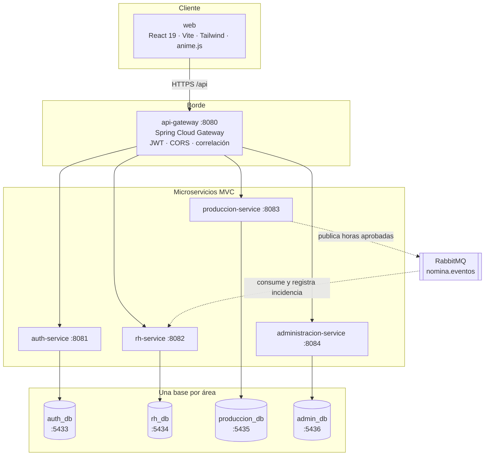
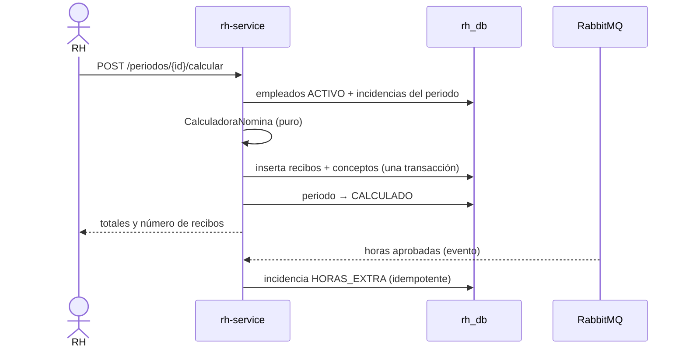
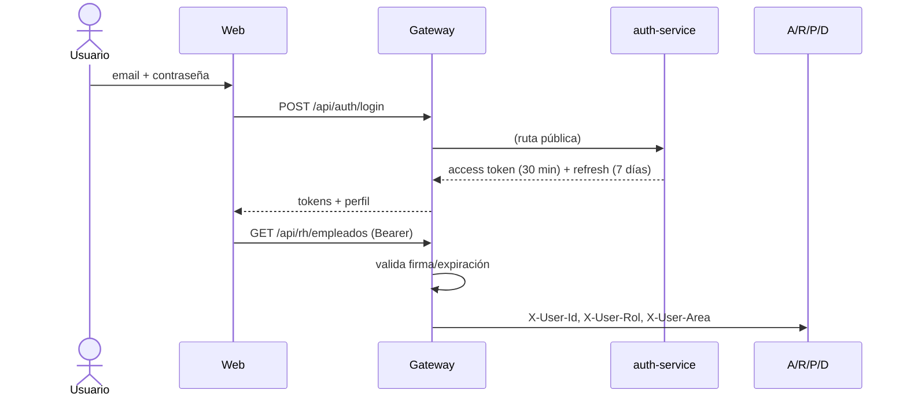

# Arquitectura

## 1. Objetivo y restricciones

Nómina360 administra la nómina de una empresa con áreas con reglas y dueños distintos
(Recursos Humanos, Producción, Administración). Las restricciones que dieron forma al diseño:

1. **Cada área es dueña de sus datos**: una base de datos por área, sin joins entre bases.
2. **El cálculo de nómina es crítico y auditable**: debe ser determinista, probado y con
   periodos inmutables una vez calculados.
3. **El frontend debe ser atractivo y modular**, con login animado y una estructura que
   "grite" el dominio, no la tecnología.
4. **Operación simple**: `docker compose up` debe levantar todo el sistema.
5. **Trazabilidad**: cada petición y cada evento debe poder rastrearse de punta a punta.

---

## 2. Principios de diseño

| Principio | Cómo se aplica |
| --- | --- |
| Bounded context | Un servicio por área; cada uno con su lenguaje y su esquema |
| Database per service | 4 instancias PostgreSQL independientes; sin acceso cruzado |
| Screaming Architecture | `features/<dominio>/` en el frontend; `dominio/`, `servicio/`, `api/` en el backend |
| MVC por capas | Controlador (HTTP) → Servicio (caso de uso/transacción) → Dominio + Repositorio |
| Contratos explícitos | DTOs (records) en el borde; entidades JPA nunca se serializan |
| Fallar rápido y claro | `ApiError` uniforme, validación en el borde, excepciones de negocio tipadas |
| Idempotencia | Consumidor de eventos con tabla `eventos_procesados`; pagos y periodos con claves únicas |
| Inmutabilidad contable | Un periodo `CALCULADO`/`CERRADO` no se recalcula; se corrige con otro periodo |

---

## 3. Vista de contenedores



### Puertos y responsabilidades

| Contenedor | Puerto | Responsabilidad | Base |
| --- | --- | --- | --- |
| `web` | 8088 (nginx) / 5173 (dev) | SPA, proxy `/api` al gateway | — |
| `api-gateway` | 8080 | Único punto de entrada, ruteo, validación JWT, CORS | — |
| `auth-service` | 8081 | Usuarios, login, refresh rotativo, perfil | `auth_db` |
| `rh-service` | 8082 | Empleados, incidencias, periodos, cálculo, recibos | `rh_db` |
| `produccion-service` | 8083 | Centros, turnos, registros de horas, aprobación, outbox | `produccion_db` |
| `administracion-service` | 8084 | Centros de costo, presupuesto, proveedores, pagos | `admin_db` |

---

## 4. MVC dentro de cada microservicio

```text
services/rh-service/src/main/java/mx/nomina360/rh/
├── RhServiceApplication.java
├── api/              # @RestController: contrato HTTP, validación, roles
├── dto/              # records de entrada/salida (nunca entidades)
├── servicio/         # casos de uso y transacciones (@Transactional)
├── nomina/           # motor de cálculo puro (sin Spring Data ni HTTP)
├── dominio/          # entidades JPA (el "modelo")
├── repositorio/      # Spring Data JPA
└── config/           # RabbitMQ, consumidores, datos iniciales
```

Reglas:

- El controlador **no** contiene reglas de negocio ni accede a repositorios.
- El servicio orquesta: valida invariantes, llama al dominio y persiste.
- El motor de nómina (`CalculadoraNomina`) es **puro**: recibe entidades/tablas y devuelve
  conceptos y totales. Eso permite probarlo sin base de datos (ver
  `CalculadoraNominaTest`).
- Las entidades no se exponen por HTTP: los DTOs evitan acoplar el contrato a JPA y filtran
  datos sensibles (CURP, RFC, NSS no salen en el catálogo de producción).

---

## 5. Modelo de datos por área

### `auth_db`
`usuarios` (rol, área, activo) · `refresh_tokens` (hash SHA-256, expiración, revocado).

### `rh_db`
`departamentos` · `puestos` · `empleados` · `periodos_nomina` · `recibos_nomina` ·
`conceptos_nomina` · `incidencias` · `tarifas_isr` · `cuotas_imss` · `parametros_nomina` ·
`eventos_procesados`.

### `produccion_db`
`centros_trabajo` · `turnos` · `registros_horas` · `evento_outbox`.

### `admin_db`
`centros_costo` · `presupuestos` · `proveedores` · `pagos`.

### Reglas de integridad entre áreas

- **No hay claves foráneas entre bases.** Las referencias son "blandas" y documentadas:
  `pagos.periodo_nomina_id` apunta a `periodos_nomina`, `registros_horas.empleado_id` apunta a
  `empleados`, `incidencias.referencia_externa` apunta al `eventoId` de producción.
- La consistencia se logra con **eventos** y con validaciones de negocio, no con transacciones
  distribuidas.
- Los datos descriptivos se **desnormalizan** a propósito cuando el área los necesita para
  operar sin consultar a otra: `registros_horas.empleado_nombre`,
  `recibos_nomina.nombre_empleado/numero_empleado`. Es un snapshot histórico, no una copia viva.

---

## 6. Flujo de cálculo de nómina



### Fórmulas implementadas

1. **Días activos**: intersección de `[fecha_ingreso, fecha_baja]` con el periodo, acotada a
   `dias_periodo`. Ingresos a mitad de periodo se prorratean.
2. **Sueldo** = `salario_diario × días_activos`.
3. **Faltas / incapacidad**: se descuentan del sueldo; la incapacidad recibe subsidio del 60 %
   (`tasa_incapacidad`), que no es gravable.
4. **Horas extra**: tarifa hora = `salario_diario / 8`; las primeras 9 horas semanales se pagan
   al 200 %, el resto al 300 % (`horas_extra_dobles_semana`).
5. **Prima vacacional** = `salario_diario × días_vacaciones × 0.25`.
6. **Base gravable** = sueldo + prima + horas extra + bonos − faltas − días de incapacidad.
7. **ISR**: se lleva la base a equivalente mensual (`base × 30 / dias_periodo`), se busca el
   tramo en `tarifas_isr`, se aplica `cuota_fija + (base − límite_inferior) × tasa` y se
   prorratea de vuelta al periodo.
8. **IMSS obrero**: `SBC = salario_diario × factor_integracion`; cuotas por concepto sobre el
   SBC y cuota adicional sobre el excedente de 3 UMA (`cuotas_imss`), por los días activos.
9. Redondeo: cada concepto a 2 decimales (HALF_UP); los totales suman conceptos ya redondeados.

> Las tablas de ISR/IMSS son de **referencia**. En producción se cargan por ejercicio y se
> validan con el área fiscal. El motor es determinista y sus pruebas fijan valores calculados
> a mano para detectar regresiones.

---

## 7. Integración asíncrona (Producción → RH)

**Problema**: aprobar horas no debe fallar si RH o RabbitMQ están caídos, y no debe duplicar
incidencias si el mensaje se entrega dos veces.

**Solución**: patrón *transactional outbox* + consumidor idempotente.

1. Al aprobar un registro con horas extra, `produccion-service` guarda el evento en
   `evento_outbox` **en la misma transacción** que el cambio de estatus.
2. Un publicador programado (`PublicadorOutbox`, cada 5 s) envía los pendientes a
   `nomina.eventos` con routing key `produccion.horas.aprobadas` y marca `publicado_en`.
3. Si RabbitMQ está caído, el evento queda pendiente y se reintenta; se incrementa `intentos`.
4. `rh-service` consume la cola `rh.horas-aprobadas`, verifica `eventos_procesados` por
   `eventoId`, y crea la incidencia con `referencia_externa = eventoId` (unique).
5. Mensajes inválidos van a la dead-letter queue `rh.horas-aprobadas.dlq`; los errores de
   infraestructura se reintentan 3 veces antes de morir.

Garantías: **at-least-once** con consumo idempotente → efecto exactly-once a nivel de negocio.
Las horas extra se suman por empleado y periodo, así que un evento duplicado no infla el pago.

---

## 8. Seguridad

### Flujo de autenticación



- **JWT HS256** con secreto de al menos 32 bytes (`JWT_SECRET`). El gateway valida y propaga
  identidad; cada servicio **vuelve a validar** el token (defensa en profundidad).
- **Access token corto** (30 min) y **refresh opaco** almacenado como hash SHA-256, con
  rotación en cada uso y revocación en logout.
- **Contraseñas** con BCrypt coste 12.
- **Autorización por rol** con `@PreAuthorize`; el menú del frontend se filtra por rol, pero la
  decisión real está en el servidor.

| Recurso | ADMIN | RH | PRODUCCIÓN | ADMINISTRACIÓN |
| --- | :-: | :-: | :-: | :-: |
| `/api/auth/me` | ✅ | ✅ | ✅ | ✅ |
| `/api/rh/resumen` | ✅ | ✅ | ✅ | ✅ |
| Empleados (CRUD) | ✅ | ✅ | ❌ | ❌ |
| Catálogo de empleados activos | ✅ | ✅ | ✅ | ❌ |
| Periodos y cálculo | ✅ | ✅ | ❌ | ❌ |
| Registros de horas | ✅ | ❌ | ✅ | ❌ |
| Presupuesto y pagos | ✅ | ❌ | ❌ | ✅ |

Otros controles: CORS restringido a orígenes configurados, `X-Correlation-Id` en todas las
respuestas, mensajes de error que no filtran detalles internos, `open-in-view=false`, y
`ddl-auto=validate` (el esquema lo gobierna Flyway, no Hibernate).

---

## 9. Frontend

### Screaming Architecture

```text
src/
├── app/                 # composición de la aplicación (rutas, App)
├── shell/               # chrome de la app: barra lateral, superior, navegación
├── shared/              # hooks y componentes transversales (no de negocio)
└── features/
    ├── auth/            # api · contexto · animaciones · model · pages
    ├── dashboard/
    ├── empleados/       # api · components · pages
    ├── nomina/
    ├── produccion/
    └── administracion/
```

Cada feature expone su `api.ts`, sus componentes y su página. Las dependencias van de
`feature → shared`, nunca entre features. Los paquetes `@nomina360/core` y
`@nomina360/ui` son la capa compartida entre futuras apps (portal del empleado, app móvil).

### Datos y estado

- Cliente HTTP propio (`@nomina360/core`) con **refresh transparente**: ante 401 renueva una
  vez y reintenta; si falla, limpia la sesión y notifica al contexto.
- `useConsulta` (clave de dependencias explícita) para lecturas con cancelación por
  `AbortController`; `useAccion` para mutaciones con estado de carga y error homogéneo.
- Validación de formularios con **zod** compartida con los tipos (`@nomina360/core/validaciones`).

### Login animado (anime.js)

La página de login compone una coreografía con una sola línea de tiempo: panel de marca,
formulario, chips, tarjetas flotantes y contadores numéricos; además, un `parallax` sutil con
el puntero y un *shake* cuando las credenciales fallan. Tres detalles de calidad:

1. **Respeta `prefers-reduced-motion`**: si el usuario pidió menos movimiento, se omite la
   animación y el contenido queda visible (no hay clases `opacity-0` en el HTML).
2. **Limpieza**: las instancias de anime se pausan al desmontar para no dejar bucles vivos.
3. **Salida animada** antes de navegar al tablero, con transición breve.

### Accesibilidad y UX

- Navegación por teclado, `aria-label` en controles, `role="alert"` en errores, foco visible.
- Estados vacíos explícitos, carga con *skeletons*/spinner, errores con reintento.
- Formato localizado (`Intl`) de moneda MXN y fechas; nunca se muestra `NaN`.

---

## 10. Observabilidad y errores

- **Correlation ID**: el gateway lo genera o lo propaga; el filtro común lo pone en MDC y en la
  respuesta. Todos los logs lo incluyen (`[corr:%X{correlationId}]`).
- **Contrato de error único** (`ApiError`): `timestamp`, `status`, `codigo`, `mensaje`, `ruta`,
  `correlationId`, `detalles[]`. Los detalles de validación indican campo y regla.
- **Actuator**: `health` (con probes de liveness/readiness), `info`, `metrics` por servicio.
- **Swagger/OpenAPI** por servicio para probar contratos sin el frontend.

---

## 11. Escalabilidad y evolución

| Punto | Situación actual | Evolución |
| --- | --- | --- |
| Servicios | Sin estado (JWT), escalan horizontalmente | Añadir réplicas y `load balancer` delante del gateway |
| Gateway | Rutas estáticas por configuración | `spring-cloud-starter-discovery` (Consul/Eureka) o service mesh |
| Mensajería | Una cola, un consumidor | Particionar por área, añadir Kafka si el volumen lo exige |
| Datos | Instancia por área | Réplicas de lectura para reportes; particionado por ejercicio en `recibos_nomina` |
| Cálculo | Síncrono por periodo | Cola de trabajos + estado `CALCULANDO` para nóminas grandes |
| Frontend | SPA | SSR/streaming si se requiere SEO o portales públicos |
| Secretos | `.env` en desarrollo | Vault / AWS Secrets Manager + rotación |
| Observabilidad | Logs + Actuator | Prometheus + Grafana + OpenTelemetry |

---

## 12. Decisiones

El detalle de cada decisión (contexto, alternativas y consecuencias) está en
[`docs/DECISIONES.md`](./DECISIONES.md).
